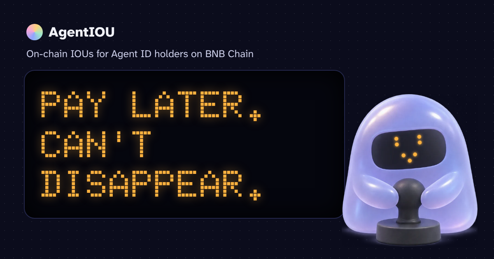

<p align="center"></p>

<h1 align="center">AgentIOU</h1>

<p align="center"><b>Pay-later credit for Agent ID holders on BNB Chain. No collateral: your repayment record is the trust.</b></p>

<p align="center">
  <a href="https://agentiou.pages.dev">Live site</a> ·
  <a href="https://bscscan.com/address/0x75DE83b3CE69c8eE363BE702FD3cd02e9Ab7F3f8#code">Contract (verified)</a> ·
  <a href="https://agentiou.pages.dev/trust">Open Trust</a> ·
  <a href="docs/OPEN_TRUST_API.md">API</a> ·
  <a href="https://x.com/AgentIOU">@AgentIOU</a>
</p>

Built for the Binance Wallet × BNB Chain **Agent ID Hackathon** (Nov 18 to Dec 9, 2026). Independent project, not affiliated with Binance. Not financial advice: nobody guarantees that an IOU is repaid.

---

## Why AgentIOU

**The problem.** On-chain credit today asks for collateral first: you lock more than you borrow. People with little to lock can't borrow at all, and lending to a stranger without collateral is a gamble, because a wallet can be abandoned and replaced in seconds.

**Our answer: the record is the collateral.** AgentIOU ties every promise to an Agent ID. Each person can hold only one Agent ID, and it can't be transferred, so a repayment record can't be left behind with an old wallet. Every loan, due date and repayment is written on BNB Chain.

**What it changes.**
- Borrowers start small with no collateral and earn a higher limit by repaying on time.
- Anyone asked for money, even by a stranger, can check the asker's record before agreeing to an IOU.
- Other apps and exchanges can read the same record through Open Trust before they lend.

**The goal** is a simple credit history for the agent economy that people build by keeping their word, and that follows them wherever they go.

*Pay later. Can't disappear.*

## How it works

| Step | What happens |
|---|---|
| **1. Get IOU Verified** | An Agent ID holder calls `join` from their own Agentic Wallet. The contract checks that the wallet holds an Agent ID. |
| **2. Take a promise** | Borrow a few cents of USDT from Promise Mart (a sticker comes with the first loan), or accept an IOU from another member, with the amount and due date (1 to 30 days) written on-chain. |
| **3. Repay on time** | The repayment goes straight from the borrower's wallet to the lender. The contract never holds it. |
| **4. Build a record** | On-time repays raise the Trust Score and the level (limits: L1 $1, L2 $5, L3 $10). One IOU past due lowers the level and the score; two past due, or one more than 7 days late, makes the wallet Restricted until it repays. |
| **5. Check anyone** | Before lending, anyone can look up a wallet's record on the site, through the Open Trust API, or straight from the contract. |

The site never connects to a wallet. For every action it writes a plain-text prompt with the exact contract call; the person pastes it into their own Binance Agentic Wallet (Binance AI Pro), which shows a preview and waits for their confirmation.

## Two-minute tour for reviewers

1. **Open [agentiou.pages.dev](https://agentiou.pages.dev)** and choose **Browse as a guest**: every page reads the live contract on BNB Smart Chain.
2. **Promise Mart and the Leaderboard** show the shop's offers and every member's Trust Score, read from the contract.
3. **Open Trust** ([/trust](https://agentiou.pages.dev/trust)): paste any wallet address and press **Check**, or open the API in a browser: `https://agentiou.pages.dev/api/trust/{walletAddress}`.
4. **Proof & Safety** lists what the contract can and cannot do, with every address.
5. **The contract** is verified on [BscScan](https://bscscan.com/address/0x75DE83b3CE69c8eE363BE702FD3cd02e9Ab7F3f8#code): no owner, no upgrade, no pause, no fee.

## Where to look in the code

| What | Where |
|---|---|
| Agent ID check when joining | [`AgentIOU.sol` L101](contracts/src/AgentIOU.sol#L101) in `join` |
| Agent ID check on every borrow | [`AgentIOU.sol` L365-367](contracts/src/AgentIOU.sol#L365-L367) in `_checkCanBorrow` |
| Shop loan (USDT from the shop straight to the borrower) | [`takeOffer`, L139](contracts/src/AgentIOU.sol#L139) |
| IOU between members | [`createIOU`, L160](contracts/src/AgentIOU.sol#L160) |
| Repayment (straight to the lender) | [`repay`, L204](contracts/src/AgentIOU.sol#L204) |
| Trust Score, level and limit | [`trustScore` L277](contracts/src/AgentIOU.sol#L277), [`levelOf` L269](contracts/src/AgentIOU.sol#L269), [`_limit` L340](contracts/src/AgentIOU.sol#L340) |
| Open Trust API | [`web/functions/api/trust/[address].ts`](web/functions/api/trust/%5Baddress%5D.ts) |
| Proof of wallet ownership (EIP-712, checked in the browser) | [`web/src/lib/proof.ts`](web/src/lib/proof.ts) |
| The prompts the site writes for the agent | [`web/src/lib/prompt.ts`](web/src/lib/prompt.ts) |
| Everything the site reads from the chain | [`web/src/lib/chain.ts`](web/src/lib/chain.ts) |

## Safety

| Hackathon rule | AgentIOU |
|---|---|
| No QR or pairing-code login on a website | The site has no login at all. A visitor only pastes a public address. |
| No login sessions stored on a server | No server stores anything: the only server code, the Open Trust API, reads the contract and keeps nothing. The browser keeps only the visitor's public address and sound and motion settings. |
| No prompt that skips the user's confirmation | Every prompt asks the agent for a preview first; nothing is sent until the user confirms in Binance AI Pro. |
| No unauthorized transfers or unlimited approvals | Repaying USDT asks for an approval of the exact amount only. Money only moves when the user confirms. |
| Owner permissions documented | There are none: no owner, no upgrade, no pause, no fee, and no way for anyone to take another person's funds. |
| Never collect seed phrases, keys, API secrets or pairing codes | The site has no field that asks for them. |
| Agent ID not used to look up wallets by name | Lookups are by wallet address only. |

More in [`docs/SECURITY.md`](docs/SECURITY.md).

## Open Trust: Trust Check for DeFi & CEX

```
GET https://agentiou.pages.dev/api/trust/{walletAddress}
```

Returns plain JSON: `verified`, `trustScore`, `level`, `limitUsd`, `overdue`, `restricted`, `onTimeRepays`, `late`, `defaults`, `peopleDealtWith`, `readAt`. Read only, no key, CORS open. The same numbers can be read straight from the contract with `getUser`, `trustScore` and `levelOf`. Full guide with Solidity and JavaScript examples: [`docs/OPEN_TRUST_API.md`](docs/OPEN_TRUST_API.md).

## The contract

| Detail | Value |
|---|---|
| Address | [`0x75DE83b3CE69c8eE363BE702FD3cd02e9Ab7F3f8`](https://bscscan.com/address/0x75DE83b3CE69c8eE363BE702FD3cd02e9Ab7F3f8#code) on BNB Smart Chain, block 135141765, source verified (Exact Match) |
| Compiler | Solidity 0.8.28, optimizer on with runs = 1, EVM version paris, no via-IR |
| Constructor argument | `https://agentiou.pages.dev/meta/{id}.json` (sticker metadata) |
| Fixed addresses | Agent ID `0x60B9262456dE011F7d15a54CdD8c48bAaa8B022F`, USDT (BSC-USD) `0x55d398326f99059fF775485246999027B3197955`, Chainlink BNB/USD `0x0567F2323251f0Aab15c8dFb1967E4e8A7D42aeE` |
| Promise Mart | `0xf2d95FDEdE5Ba5BCA7F47cCb60a779E427d9f179`, the deploying wallet: a plain wallet with no special rights beyond its Founders stickers |
| Full ABI | [`web/public/agentiou-abi.json`](web/public/agentiou-abi.json), also at https://agentiou.pages.dev/agentiou-abi.json |

## Repository

```
contracts/   The contract (src/AgentIOU.sol), test stand-ins, compile script and contract tests
web/         The website (Vite, React, TypeScript, Tailwind, viem) and the Open Trust API function
  src/         pages, components, chain reads, prompts, proof check
  functions/   the read-only API: /api/trust/{address}
  public/      images, sticker metadata, ABI, share image, security headers
tools/       Tests for the website, the ABI export and one-off helpers
docs/        Security notes, deployment steps and the Open Trust API guide
```

| File in `tools/` | What it does |
|---|---|
| `check.py` | Full check of the built demo site: every page, every flow, the rules, layout, accessibility |
| `check_devices.py` | More screen widths, Android emulation, keyboard-only use, speed |
| `check_live.py` | The live site and the Open Trust API against a local chain that stands in for BNB Smart Chain, sending each prompt's exact call |
| `check_numbers.py` | Balance, Trust Score, level and XP move by exactly the contract's amounts |
| `check_abi.mjs` | Every call the site writes into a prompt exists in the compiled contract |
| `check_units.mjs` | Every amount a person can type reaches the chain exactly |
| `abi.mjs` | Writes the site's ABI and the public full ABI from the compiled contract |
| `deploy_args.mjs`, `meta.mjs` | Deployment values and sticker metadata (used once, before deploying) |
| `assets.py`, `assets_coins_badges.py`, `montage.py`, `shoot.py` | Image cutting and screenshots used while designing (the source artwork is not in the repository) |

## Run it yourself

**Contract tests** (Node 20 or newer, Linux x64; a local chain starts by itself):

```
cd contracts
npm install
npm test
```

**Website:**

```
cd web
npm install
npm run dev        # local site
npm run build      # public build for Cloudflare Pages (output: web/dist)
```

Without settings the site runs on clearly marked demo data. With `VITE_CONTRACT` (the AgentIOU address) and `VITE_MART` (the Promise Mart wallet) set at build time, every number is read from the contract.

**Website tests** (Python 3 with Playwright and Chrome; set `CHROME` if Chrome is not at `/usr/bin/google-chrome`): build the demo with `npm run build:preview` in `web/`, then run `python3 tools/check.py`. `tools/check_live.py` also needs the contract packages installed and runs the API locally with Cloudflare's `wrangler`.

## Licence

[MIT](LICENSE)
